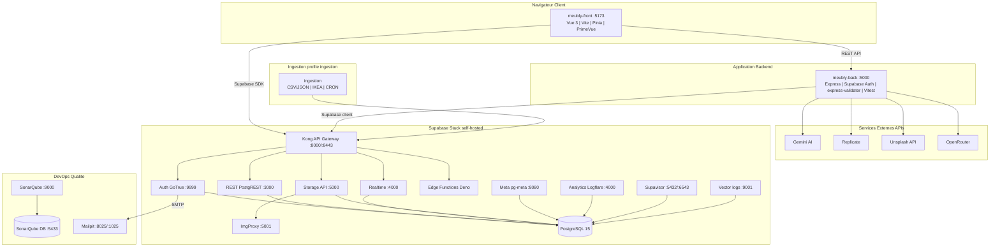

# Architecture Technique — Meubly

## Vue d'ensemble

Meubly repose sur une architecture **web full-stack** composée de :
- un **frontend Vue 3** (`meubly-front`) ;
- un **backend Express.js** (`meubly-back`) ;
- une stack **Supabase self-hosted** (API Gateway, Auth, REST, Realtime, Storage, DB, etc.) ;
- des **services externes IA/media** (Gemini, Replicate, Unsplash, OpenRouter) ;
- des briques **ops/qualité** (SonarQube, Mailpit) ;
- un service d'**ingestion batch** optionnel.

L'objectif est de centraliser la logique métier dans `meubly-back`, tout en s'appuyant sur Supabase pour les capacités de plateforme (auth, données, realtime, storage).

## Diagramme d'architecture (global)



## Composants et responsabilites

| Composant | Role principal | Port(s) |
|---|---|---|
| `meubly-front` | UI client (recherche, consultation, auth côté app) | `5173` |
| `meubly-back` | API métier, orchestration appels Supabase + IA externes | `5000` |
| `kong` | Point d'entrée API Supabase (proxy/gateway) | `8000`, `8443` |
| `auth` | Authentification Supabase (GoTrue, JWT) | `9999` |
| `rest` | Exposition REST de PostgreSQL via PostgREST | `3000` (interne) |
| `realtime` | Abonnements temps réel (channels/events) | `4000` |
| `storage` | Gestion des objets/fichiers | `5000` (interne) |
| `functions` | Exécution Edge Functions | interne |
| `db` | Base principale PostgreSQL 15 | `5432` (via pooler) |
| `supavisor` | Pooling connexions PostgreSQL | `5432`, `6543` |
| `studio` | Interface d'admin Supabase | `3000` (exposé via stack locale) |
| `meta` | Métadonnées/administration PostgreSQL | `8080` |
| `analytics` | Collecte/consultation logs analytics | `4000` |
| `vector` | Collecte et routage des logs | `9001` |
| `imgproxy` | Transformation d'images | `5001` |
| `mailpit` | SMTP + UI de test email | `1025`, `8025` |
| `ingestion` | Import batch (CSV/JSON, IKEA adapter) | profil dédié |
| `sonarqube` | Analyse qualité du code | `9000` |
| `sonarqube_db` | DB dédiée SonarQube | `5433` |

## Flux applicatifs principaux

### 1) Flux utilisateur (front → back)
1. Le navigateur charge `meubly-front`.
2. Le frontend appelle `meubly-back` (`/api/v1/...`) pour la logique métier.
3. Le backend interroge Supabase via `kong` (auth, DB, storage) selon le besoin.
4. Le backend renvoie une réponse agrégée/normalisée au frontend.

### 2) Flux data direct Supabase (front → Supabase)
Le frontend peut aussi utiliser le SDK Supabase pour certains cas (auth/session, données ciblées), en passant par `kong`.

### 3) Flux IA / enrichissement
`meubly-back` appelle les services externes (`Gemini`, `Replicate`, `OpenRouter`, `Unsplash`) pour enrichir ou générer du contenu exploité côté app.

### 4) Flux ingestion (batch)
Le service `ingestion` tourne via un profil Docker dédié et pousse les données vers Supabase (`kong`) à intervalles CRON ou en run ponctuel.

## Donnees et persistance

- La persistance principale repose sur `db` (**PostgreSQL 15**) de la stack Supabase.
- Les médias transitent par `storage`, avec transformation possible via `imgproxy`.
- Les logs techniques passent par `vector` et `analytics`.
- Les emails de dev (auth, notifications éventuelles) sont capturés par `mailpit`.

## Profils Docker utilises

| Profil | Usage |
|---|---|
| `sonar` | Démarre `sonarqube` + `sonarqube_db` |
| `ingestion` | Démarre le service batch `ingestion` |
| `app` | Utilisé avec `docker-compose.dev.yml` pour front/back en mode dev (voir `README.md`) |

## Qualite de code (SonarQube)

La stack SonarQube est intégrée au projet avec un profil dédié.

### Demarrer SonarQube

```bash
docker compose --profile sonar up -d
```

Accès : `http://localhost:9000` (première connexion par défaut : `admin` / `admin`).

### Configs de scan

- `meubly-back/sonar-project.properties`
- `meubly-front/sonar-project.properties`

### Lancer une analyse (exemple backend)

```bash
cd meubly-back
npm run test:coverage

# depuis la racine du repo (PowerShell)
$env:SONAR_TOKEN="VOTRE_TOKEN"
$p=(Get-Location).Path
docker run --rm `
  -e SONAR_HOST_URL="http://host.docker.internal:9000" `
  -e SONAR_TOKEN=$env:SONAR_TOKEN `
  -v "$p/meubly-back:/usr/src" `
  sonarsource/sonar-scanner-cli:latest
```

## Ports et URLs utiles en local

| Service | URL |
|---|---|
| Frontend | `http://localhost:5173` |
| Backend API | `http://localhost:5000/api/v1` |
| Supabase Gateway (Kong) | `http://localhost:8000` |
| Supabase Studio | `http://localhost:3000` |
| SonarQube | `http://localhost:9000` |
| Mailpit UI | `http://localhost:8025` |

## Limites actuelles / points d'attention

- Plusieurs services Supabase exposent des ports internes identiques (ex: `4000`, `5000`), mais l'accès externe reste gouverné par le gateway et la config Docker.
- Le backend centralise les appels externes IA : surveiller quotas, timeouts, et fallback en cas d'indisponibilité fournisseur.
- Pour SonarQube, penser à générer la couverture (`lcov`) avant scan pour des résultats exploitables.

