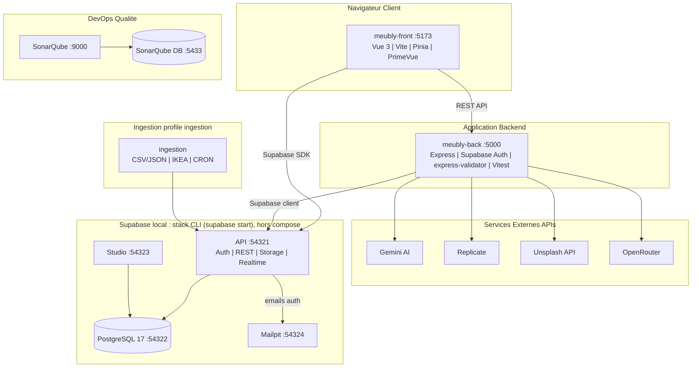

# Architecture Technique — Meubly

## Vue d'ensemble

Meubly repose sur une architecture **web full-stack** composée de :
- un **frontend Vue 3** (`meubly-front`) ;
- un **backend Express.js** (`meubly-back`) ;
- **Supabase** (Auth, REST, Realtime, Storage, PostgreSQL 17) : stack CLI en local (`supabase start`), projet cloud en prod ; schema decrit dans `docs/diagrams/data-model.md` ;
- des **services externes IA/media** (Gemini, Replicate, Unsplash, OpenRouter) ;
- des briques **ops/qualité** (SonarQube, Mailpit) ;
- un service d'**ingestion batch** optionnel.

L'objectif est de centraliser la logique métier dans `meubly-back`, tout en s'appuyant sur Supabase pour les capacités de plateforme (auth, données, realtime, storage).

## Diagramme d'architecture (global)



## Composants et responsabilites

| Composant | Role principal | Port(s) |
|---|---|---|
| `meubly-front` | UI client (recherche, consultation, auth côté app) | `5173` |
| `meubly-back` | API métier, orchestration appels Supabase + IA externes | `5000` |
| Stack Supabase CLI | API (auth, REST, storage, realtime), PostgreSQL 17, Studio, Mailpit ; lancee par `npx supabase@2.122.1 start`, hors compose | `54321` a `54324` |
| `ingestion` | Import batch (CSV/JSON, IKEA adapter) | profil dédié |
| `sonarqube` | Analyse qualité du code | `9000` |
| `sonarqube_db` | DB dédiée SonarQube | `5433` |

## Flux applicatifs principaux

### 1) Flux utilisateur (front → back)
1. Le navigateur charge `meubly-front`.
2. Le frontend appelle `meubly-back` (`/api/v1/...`) pour la logique métier.
3. Le backend interroge Supabase (auth, DB, storage) : en local via `http://host.docker.internal:54321` depuis son conteneur.
4. Le backend renvoie une réponse agrégée/normalisée au frontend.

### 2) Flux data direct Supabase (front → Supabase)
Le frontend peut aussi utiliser le SDK Supabase pour certains cas (auth/session, données ciblées), via l'API Supabase (`http://localhost:54321` en local).

### 3) Flux IA / enrichissement
`meubly-back` appelle les services externes (`Gemini`, `Replicate`, `OpenRouter`, `Unsplash`) pour enrichir ou générer du contenu exploité côté app.

### 4) Flux ingestion (batch)
Le service `ingestion` tourne via un profil Docker dédié et pousse les données vers Supabase (`host.docker.internal:54321` en local) à intervalles CRON ou en run ponctuel.

## Donnees et persistance

- La persistance repose sur **PostgreSQL 17** (Supabase cloud en prod, stack CLI en local), schema versionne dans `supabase/migrations/`.
- Les médias transitent par Supabase Storage (bucket `ai-generated`).
- Les emails de dev (auth) sont captures par le Mailpit de la stack CLI.

## Profils Docker utilises

| Profil | Usage |
|---|---|
| `sonar` | Démarre `sonarqube` + `sonarqube_db` |
| `ingestion` | Démarre le service batch `ingestion` |
| `app` | Utilisé avec `docker-compose.dev.yml` pour front/back en mode dev (voir `README.md`) |

## Qualite de code (SonarQube)

La stack SonarQube est intégrée au projet avec un profil dédié.

### Demarrer SonarQube

```bash
docker compose --profile sonar up -d
```

Accès : `http://localhost:9000` (première connexion par défaut : `admin` / `admin`).

### Configs de scan

- `meubly-back/sonar-project.properties`
- `meubly-front/sonar-project.properties`

### Lancer une analyse (exemple backend)

```bash
cd meubly-back
npm run test:coverage

# depuis la racine du repo (PowerShell)
$env:SONAR_TOKEN="VOTRE_TOKEN"
$p=(Get-Location).Path
docker run --rm `
  -e SONAR_HOST_URL="http://host.docker.internal:9000" `
  -e SONAR_TOKEN=$env:SONAR_TOKEN `
  -v "$p/meubly-back:/usr/src" `
  sonarsource/sonar-scanner-cli:latest
```

## Ports et URLs utiles en local

| Service | URL |
|---|---|
| Frontend | `http://localhost:5173` |
| Backend API | `http://localhost:5000/api/v1` |
| API Supabase (CLI) | `http://127.0.0.1:54321` |
| Supabase Studio | `http://127.0.0.1:54323` |
| SonarQube | `http://localhost:9000` |
| Mailpit UI | `http://127.0.0.1:54324` |

## Limites actuelles / points d'attention

- Le backend centralise les appels externes IA : surveiller quotas, timeouts, et fallback en cas d'indisponibilité fournisseur.
- Pour SonarQube, penser à générer la couverture (`lcov`) avant scan pour des résultats exploitables.

