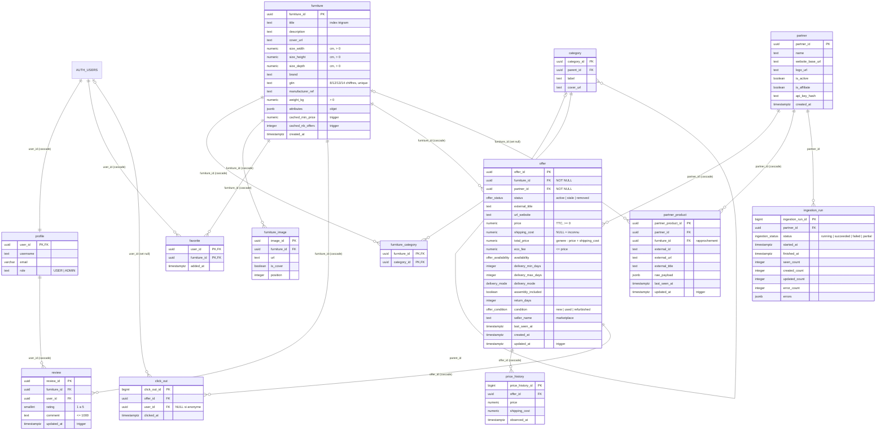

# Modele de donnees (schema `public`)

Etat a la fin de la phase 2 (2026-11-06). Source de verite : `supabase/migrations/` ; ce diagramme
en est le reflet (verifie par `db diff` local vs prod). Les colonnes `ai_*` de `furniture`
(enrichissement IA) sont omises pour la lisibilite.

## Regles portees par la base

- **Unicite d'une annonce** : `offer_unique_listing UNIQUE NULLS NOT DISTINCT (furniture_id, partner_id, seller_name, condition)`.
- **Caches du meuble** : `refresh_furniture_offer_cache()` recalcule `cached_min_price` (prix article minimum) et `cached_nb_offers` sur les offres `active`, a chaque insertion, suppression, ou changement de `furniture_id`, `price` ou `status`.
- **Historique** : `record_price_history()` ajoute une ligne a la creation de l'offre et a chaque changement effectif de `price` ou `shipping_cost`.
- **Horodatage** : `set_updated_at()` sur `offer`, `partner_product`, `review`.
- **Droits** : voir `docs/security-matrix.md`.
