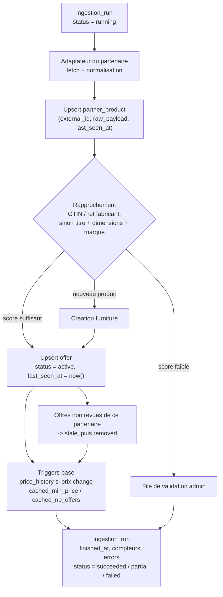

# Flux d'ingestion cible (phase 3)

Cible, pas encore implementee : les scripts actuels de `bd/ingestion/` sont geles depuis la
phase 2 et incompatibles avec le schema (ils ecrivent `offer.is_active`, supprimee, et les caches
du meuble, desormais maintenus par trigger). Ils seront reecrits selon ce flux.

Points de conception retenus en phase 2 :
- l'ingestion n'ecrit jamais `cached_min_price` / `cached_nb_offers` ni `price_history` : la base s'en charge ;
- une offre revue sans changement de prix ne cree pas de ligne d'historique ;
- `ingestion_run` et `click_out` ne sont accessibles qu'au service role.
