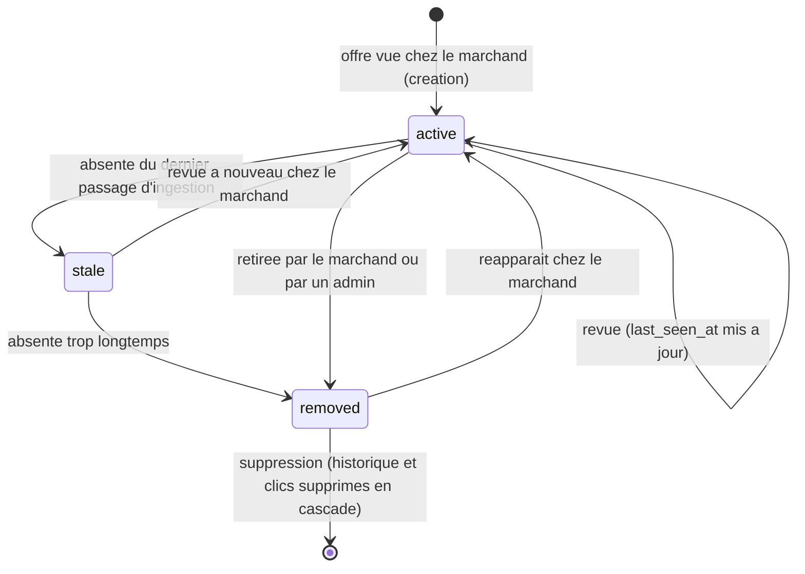

# Etats d'une offre (`offer.status`)

Enum `public.offer_status` (phase 2). Seules les offres `active` sont visibles du public
(politique RLS `offer_read_active`), comptent dans les caches du meuble et exposent leur
historique de prix. Les transitions seront pilotees par l'ingestion en phase 3 ; en phase 2,
toutes les offres existantes sont `active`.

| Etat | Visible du public | Compte dans `cached_*` | Historique lisible |
|---|---|---|---|
| `active` | oui | oui | oui |
| `stale` | non | non | non |
| `removed` | non | non | non |

Le seuil "absente trop longtemps" sera fixe avec la planification de l'ingestion (phase 3).
